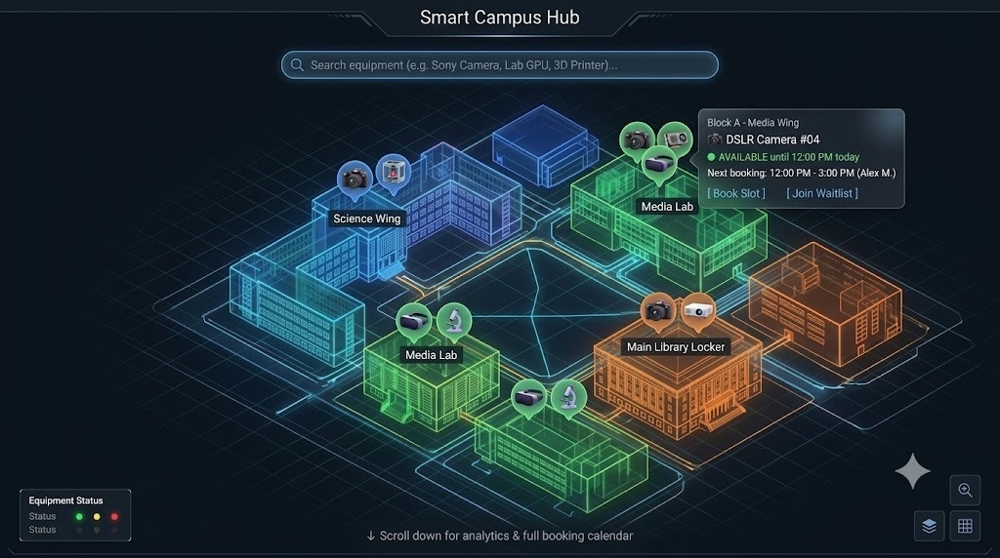

# ZeroClash 🚀
### Smart Campus Shared Equipment Booking & Real-Time Conflict Resolution Hub



**ZeroClash** is a next-generation campus resource management platform and 3D digital twin interface designed to eliminate reservation clashes, ghost bookings, and idle equipment across university research labs, media studios, and engineering departments.

Built for **Team GALACTICOS** (Problem Statement 7: Shared Equipment Booking & Conflict Management).

---

## 🌟 Key Highlights & Features

### 🏢 3D Isometric Digital Twin Campus
- **WebGL Interactive Map**: Procedural translucent neon edge-glow architecture built using Three.js, React Three Fiber, and Drei.
- **Dynamic Floating Pins**: Real-time status teardrop badges with icon indicators and bobbing micro-animations indicating exact equipment locations.
- **Smart Focus Camera**: Smooth orbital navigation and auto-centering on selected labs and hardware units.

### ⚡ Zero-Overlap Booking & Conflict Detection
- **Instant Interval Validation**: Real-time clash detection preventing overlapping reservations:
  $$\text{start\_time} < \text{requested\_end} \quad \land \quad \text{end\_time} > \text{requested\_start}$$
- **Concurrency Control & Integrity**: Built to prevent double-booking race conditions.
- **Hardware Maintenance Lockout**: Flag units for unscheduled calibration or emergency maintenance with real-time lockout indicators.

### 📋 Priority Waitlist Management
- **Automated Waitlist Promotion**: Cascading queue reallocation upon reservation cancellations.
- **Waitlist Priority Ranking**: Calculates priority windows based on urgency, role weight, and borrower reliability.

### 🔍 Real-Time Fuzzy Search & Filtering
- Instant campus-wide search across hardware types, building names, lab room numbers, and equipment IDs.
- Automatic visual filtering: highlights matching gear while dimming non-relevant campus structures.

### 🎨 Glassmorphic Cyberpunk UI
- Dark neon visual design with responsive modals, drawer panels, status pill badges, and quick-action toolbars.

---

## 🛠️ Tech Stack

- **Framework**: [React 19](https://react.dev/) + [TypeScript](https://www.typescriptlang.org/)
- **Build Tool**: [Vite 6](https://vitejs.dev/)
- **3D Graphics & Shaders**: [Three.js](https://threejs.org/), [@react-three/fiber](https://docs.pmnd.rs/react-three-fiber), [@react-three/drei](https://github.com/pmndrs/drei), [@react-three/postprocessing](https://github.com/pmndrs/react-three-postprocessing)
- **Styling**: [Tailwind CSS 3](https://tailwindcss.com/)
- **State Management**: [Zustand](https://github.com/pmndrs/zustand)
- **Icons**: [Lucide React](https://lucide.dev/)

---

## 🚀 Getting Started

### Prerequisites
- [Node.js](https://nodejs.org/) (v18.x or later recommended)
- `npm` or `pnpm` or `yarn`

### Installation

1. **Clone the repository**:
   ```bash
   git clone https://github.com/Awwad-007/ZeroClash.git
   cd ZeroClash
   ```

2. **Install dependencies**:
   ```bash
   npm install
   ```

3. **Start the local development server**:
   ```bash
   npm run dev
   ```

4. **Build for production**:
   ```bash
   npm run build
   ```

5. **Preview production build**:
   ```bash
   npm run preview
   ```

---

## 📁 Project Structure

```
ZeroClash/
├── public/
│   └── assets/
│       ├── icons/              # Equipment 3D/2D badge icons
│       └── equipment-sheet.jpeg
├── reference/
│   └── campus-hub.jpeg         # Design reference & preview
├── scripts/
│   └── crop_icons.py           # Asset pipeline script
├── src/
│   ├── components/             # UI Components (Modals, Panels, Header, Search)
│   ├── data/                   # Campus buildings & equipment mock data
│   ├── scene/                  # Three.js / React Three Fiber campus scene
│   ├── store/                  # Zustand global state (bookings, equipment, filters)
│   ├── App.tsx                 # Main layout & overlay logic
│   ├── index.css               # Tailwind & custom glow styling
│   └── main.tsx                # Application entrypoint
├── index.html
├── package.json
├── tailwind.config.js
├── tsconfig.json
└── vite.config.ts
```

---

## 🛡️ License

This project is licensed under the MIT License.
