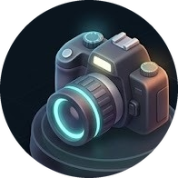
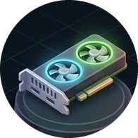
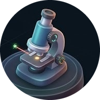
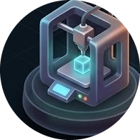
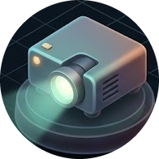
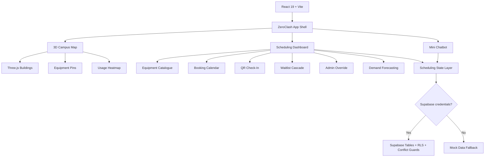

# ZeroClash

<p align="center">
  
</p>

<p align="center">
  <strong>A premium smart-campus equipment booking platform with a 3D digital twin, clash-free scheduling, QR check-in, waitlist automation, admin controls, demand intelligence, and Supabase-ready persistence.</strong>
</p>

<p align="center">
  
  
  
  
  
</p>

---

## The Idea

ZeroClash is a full-stack-ready campus equipment reservation system built to solve a very real college problem: shared cameras, projectors, VR headsets, microscopes, GPUs, printers, and testing kits often get double-booked, misplaced, underused, or blocked by unclear maintenance schedules.

Instead of presenting equipment booking as a boring table, ZeroClash turns the entire campus into an interactive command center:

- A 3D campus map shows where equipment actually lives.
- A compact Apple-style booking calendar prevents clashes before they happen.
- A waitlist cascade automatically reallocates cancelled slots.
- QR check-in/check-out validates real booking tickets.
- Admin override tools handle exceptional requests with audit trails.
- Demand forecasting reveals which equipment will be under pressure next.
- Supabase persistence is ready, while mock fallback keeps the project instantly runnable.

This project is designed to feel like a polished product demo, not a static prototype.

---

## Submission Snapshot

| Area | What ZeroClash Delivers |
| --- | --- |
| Campus experience | Interactive 3D digital twin with building selection, equipment pins, camera controls, and usage heatwaves |
| Booking safety | Conflict-aware booking creation, cancellation, maintenance lockouts, and overlap prevention |
| Calendar | Day, week, and month booking views with compact equipment icons and readable event details |
| Waitlist | Priority scoring, queue positions, 10-minute offer windows, accept/decline/cancel flows |
| QR workflow | Unique QR per confirmed booking, scanner flow, manual fallback, validation, check-in, and check-out |
| Admin tools | Approvals, rejection, conflict resolution, maintenance blocks, reasons, and audit log |
| Forecasting | Demand charts, category ranking, unit ranking, utilization heatmap, supply vs demand |
| Assistant | Floating mini chatbot for availability, booking steps, conflicts, and QR help |
| Persistence | Supabase schema, RLS policies, overlap guard, env-based credentials, mock fallback |
| UI quality | Light/dark themes, responsive sidebar, compact cards, icon-first equipment design |

---

## Visual Highlights

### 3D Campus Digital Twin

ZeroClash opens with a full-screen interactive campus model built with Three.js and React Three Fiber. Buildings are rendered as detailed procedural architecture with lit windows, roofs, antennas, entrance details, and hover/selection states.

The map is not decoration. It is connected to the actual equipment data.

- Select buildings to inspect location-based availability.
- View live equipment pins above buildings.
- Toggle the usage heatmap directly on the 3D scene.
- Rotate, zoom, and inspect the campus without leaving the booking flow.

### Equipment Icon System

The app uses compact equipment icons across the catalogue, calendar, waitlist, map pins, and QR booking views.

| Camera | GPU | VR | Microscope | Printer | Projector | Lab Kit | Device |
| --- | --- | --- | --- | --- | --- | --- | --- |
|  |  |  |  |  |  |  |  |

---

## Core Features

### 1. 3D Campus Map

The campus map is the visual center of the application.

- Procedural 3D buildings with campus-specific placement.
- Building selection and deselection.
- Equipment pins positioned on building rooftops.
- Compact contextual building cards.
- Usage Heatmap toggle with green, yellow, orange, and red intensity waves.
- Heatwaves stay attached to the correct buildings during orbit, zoom, and camera movement.
- Grid, zoom, reset, and view controls.
- Clean light/dark theme support.

### 2. Equipment Catalogue

The equipment page acts as the inventory layer for the system.

- Searchable equipment catalogue.
- Category filters.
- Availability filters.
- Equipment icons, names, units, locations, and statuses.
- Quick navigation to map context.
- Booking entry points for available equipment.

Supported equipment types:

- DSLR Camera
- GPU Cluster
- VR Headset
- Microscope
- 3D Printer
- Projector
- Lab Kit
- Testing Device

### 3. Booking Calendar

ZeroClash includes a compact calendar inspired by modern scheduling apps.

- Day, week, and month views.
- Today button and date navigation.
- Category and availability filters.
- Search by equipment or building.
- Icon-first booking indicators.
- Event details dialog.
- Booking creation from calendar slots.
- Booking cancellation.
- Conflict-aware interval validation.
- Compact month view with `+N more` behavior.
- Responsive horizontal scrolling for dense timelines.

The calendar focuses on what matters: equipment, time, status, and action.

### 4. Waitlist Cascade

The waitlist module simulates a realistic queue and reallocation engine.

- Compact equipment tile grid.
- Queue position tracking.
- Transparent priority score.
- Role, urgency, and no-show penalty inputs.
- Requested time slots.
- 10-minute offer windows.
- Accept, decline, expire, and cancel flows.
- Automatic cascade to the next eligible user when a slot opens.
- Calendar state updates when an offer becomes a booking.

Priority formula:

```text
Role weight + urgency x 12 - no-show penalty x 2
```

### 5. Admin Override Console

Exceptional booking cases need careful controls. The admin dashboard provides that layer.

- Approve pending requests.
- Reject requests.
- Resolve exceptional conflicts.
- Block equipment for maintenance.
- Clear maintenance.
- Trigger waitlist override decisions.
- Require a reason for every admin action.
- Show actor, reason, action, target, and timestamp in the audit log.
- Prevent overlapping confirmed bookings.
- Prevent unsafe maintenance bypasses.

### 6. QR Check-In and Check-Out

ZeroClash turns bookings into verifiable tickets.

- Unique QR token per confirmed booking.
- My Bookings section.
- QR display for selected booking.
- Camera scan flow where supported by the browser.
- Manual booking ID or QR payload fallback.
- Booking ID, equipment ID, start time, and QR token validation.
- Check-in only within valid booking rules.
- Check-out only after check-in.
- Duplicate check-in/check-out prevention.
- Status and timestamp updates shared with the booking system.

### 7. Demand Forecasting

The forecasting dashboard makes scheduling data readable.

- Predicted request counts.
- Utilization percentage.
- Peak usage periods.
- Shortage risk indicators.
- Historical vs forecast chart.
- Highest demand categories.
- Ranked equipment units.
- Day x hour utilization heatmap.
- Demand by building.
- Supply vs demand chart.
- Recommendation cards.

### 8. Mini Chatbot

ZeroClash includes a floating assistant in the bottom-right corner.

Supported questions:

- Equipment availability.
- How to book equipment.
- Booking conflicts.
- QR check-in/check-out.

The assistant includes:

- Suggested question chips.
- Natural-language input.
- Typing animation.
- Concise responses.
- Responses based on current app data where available.
- A clean architecture ready for a real AI API later.

It does not pretend that an external AI service is connected.

### 9. Supabase-Ready Persistence

ZeroClash can run instantly with local mock data, but it is also prepared for Supabase persistence.

Included:

- Supabase client setup.
- Environment-variable credentials.
- Equipment table.
- Bookings table.
- Waitlist table.
- Audit log table.
- Row Level Security policies.
- Active booking overlap prevention with a PostgreSQL exclusion constraint.
- Mock fallback if credentials are not present.

No secret keys are committed.

---

## Architecture



---

## Tech Stack

| Layer | Technology |
| --- | --- |
| Frontend | React 19, TypeScript, Vite |
| 3D | Three.js, React Three Fiber, Drei, Postprocessing |
| Styling | Tailwind CSS, custom theme tokens |
| State | React state, Zustand for campus map state |
| Icons | Lucide React plus custom equipment image icons |
| Persistence | Supabase client with mock fallback |
| Database safety | PostgreSQL RLS and booking overlap exclusion constraint |
| Build | TypeScript project build plus Vite production bundle |

---

## Project Structure

```text
ZeroClash-main/
├── public/
│   └── assets/
│       ├── equipment-sheet.jpeg
│       └── icons/
├── reference/
│   └── campus-hub.jpeg
├── src/
│   ├── components/
│   │   ├── AdminOverrideDashboard.tsx
│   │   ├── AnalyticsPlaceholder.tsx
│   │   ├── DemandIntelligenceDashboard.tsx
│   │   ├── EquipmentCatalog.tsx
│   │   ├── EquipmentIconTile.tsx
│   │   ├── GanttBookingCalendar.tsx
│   │   ├── MiniChatbot.tsx
│   │   ├── MyBookingsQRCode.tsx
│   │   ├── SidebarNav.tsx
│   │   └── WaitlistCascadeDashboard.tsx
│   ├── data/
│   │   └── mock.ts
│   ├── lib/
│   │   ├── schedulingData.ts
│   │   ├── supabaseClient.ts
│   │   └── supabaseScheduling.ts
│   ├── scene/
│   │   ├── BuildingMesh.tsx
│   │   ├── CampusCanvas.tsx
│   │   ├── CampusGround.tsx
│   │   └── EquipmentPins.tsx
│   ├── store/
│   │   └── campusStore.ts
│   ├── types/
│   │   └── scheduling.ts
│   └── utils/
│       ├── forecasting.ts
│       ├── qrCode.ts
│       └── usageHeatmap.ts
├── supabase/
│   └── migrations/
├── package.json
├── tailwind.config.js
└── vite.config.ts
```

---

## Getting Started

### 1. Clone

```bash
git clone https://github.com/Saamia18/ZEROCLASH.git
cd ZEROCLASH
```

### 2. Install

```bash
npm install
```

### 3. Run

```bash
npm run dev
```

Open:

```text
http://127.0.0.1:5173
```

### 4. Build

```bash
npm run build
```

### 5. Preview Production Build

```bash
npm run preview
```

---

## Optional Supabase Setup

ZeroClash works without Supabase. If credentials are missing, it uses the built-in mock data fallback.

To enable persistence:

### 1. Create `.env`

```env
VITE_SUPABASE_URL=https://your-project-ref.supabase.co
VITE_SUPABASE_ANON_KEY=your-public-anon-key
```

### 2. Run Migrations

Run the SQL files inside:

```text
supabase/migrations/
```

The main schema migration creates:

- `zero_clash_equipment`
- `zero_clash_bookings`
- `zero_clash_waitlist_entries`
- `zero_clash_audit_log`

It also enables RLS and prevents overlapping active bookings.

### 3. Restart Dev Server

```bash
npm run dev
```

---

## Judge Walkthrough

For a high-impact demo, walk through the project in this order:

1. Open the 3D Campus Map and rotate the campus.
2. Toggle Usage Heatmap to show live intensity waves.
3. Select a building and inspect equipment availability.
4. Open Equipment Catalogue and filter by category/status.
5. Use the Booking Calendar to create or inspect a booking.
6. Open My Bookings and show the QR code flow.
7. Use Waitlist Cascade to inspect priority scores and offer windows.
8. Open Admin Override and show the audit log.
9. Open Demand Intelligence and show the forecast/heatmap charts.
10. Open the Mini Chatbot and ask: `What equipment is available?`

---

## What Makes ZeroClash Stand Out

- It is visual, not just functional.
- It solves the complete booking lifecycle.
- It connects physical campus space with scheduling data.
- It prevents the core failure case: overlapping bookings.
- It supports maintenance and admin exceptions.
- It includes QR validation rather than simple status toggles.
- It has forecasting, waitlisting, and auditability.
- It is ready for persistence but still runnable instantly.

ZeroClash is built to feel like a real campus operations product: fast, modern, visual, and practical.

---

## Build Status

Latest local production build:

```bash
npm run build
```

Expected result:

```text
tsc -b && vite build
build completed successfully
```

Note: Vite may warn about large chunks because the project includes a full 3D rendering stack. The build still completes successfully.

---

## License

MIT License.
